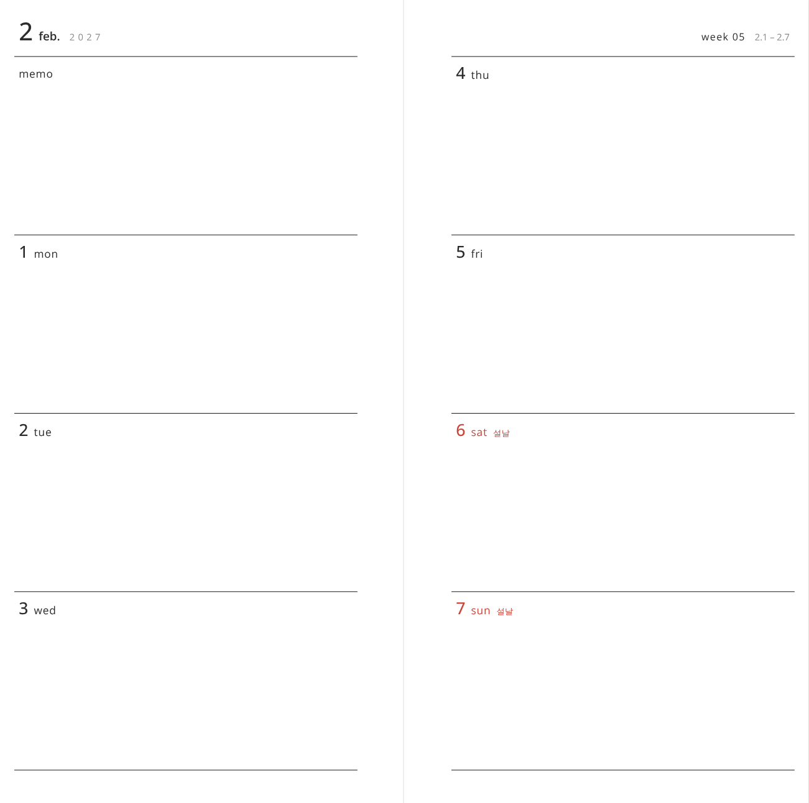

# Diary Weekly Generator

[한국어](README.md) | **English**

A browser-based editor (Korean UI) for making weekly inserts for system diaries and saving them as PDFs. Nothing to install.

**Open the editor:** https://mov-ie.github.io/diary-weekly-generator/

## What it makes

One week per two-page spread. Each page has 4 boxes, so a spread has 8 boxes of the same size.

- **Left page:** a memo box at the top, then the first 3 days (Mon, Tue, Wed when the week starts on Monday)
- **Right page:** the other 4 days (Thu, Fri, Sat, Sun)
- **Header line:** month and year above the left page; week number (week 05) and date range (2.1 – 2.7) above the right page

The default size is 86×171mm, and you can set any size you like.

## Features

- **Date range:** pick a start date and an end date, and it makes every week from the one holding the start date to the one holding the end date (up to 110 weeks at a time).
- **Week start:** Monday (default) or Sunday.
- **Memo box name:** memo by default; rename it to anything, such as to do or note.
- **Undated:** weekday names only, no dates, for as many weeks as you choose.
- **Header:** month style (1 / 01 / jan / 1 jan.), and year, week number and date range can each be turned on or off. A week that crosses into a new month shows "3 mar. – 4 apr.", and the 1st of the month gets its month in its box ("1 apr."). Week numbers follow ISO 8601.
- **Red days:** Sundays and Korean public holidays (including substitute holidays) are printed in red, with the holiday name in the box. Holidays are updated automatically every month (see below). You can add your own dates, and a name typed after the date shows in the box.
- **Fonts:** Open Sans (default), Jost and others, or type the name of any font installed on your computer. Month, date and weekday sizes, weekday style (mon / MON), italics.
- **Colors and lines:** line color (#1A1A1A by default), line weight, text color, red-day color, year/range color, Saturday color. Colors can be picked or typed as a hex code (#1A1A1A).
- **Size and margins:** insert width and height, top and bottom margins, ring-side margin (10mm by default), outer margin, header height.
- **Ring position:** the preview shows the ring area as a light band with dashed lines and outlined holes (6-ring bible layout). It is screen-only and never prints.
- **Output:** save at insert size, or lay out several pages on A4 or A5 with crop marks, single- or double-sided.

## How to use

1. Open the page.
2. In the left panel, set the **start date** (시작 날짜), **end date** (끝 날짜) and **week start** (주 시작).
3. Adjust the memo box name, fonts, colors and margins. The preview on the right updates instantly.
4. Choose the **output paper** (출력 용지):
   - **Insert size** (속지 크기): one page at a time at the real size.
   - **A4 / A5:** several pages per sheet. Three 86×171mm pages fit on a landscape A4 sheet, one on A5.
5. Click **PDF로 저장 / 인쇄** (Save as PDF / Print) at the bottom, then choose **Save as PDF** in the print dialog.

Your settings are saved in the browser, so they're still there next time. Click **처음 설정으로 되돌리기** (Reset to defaults) to start over.

## Automatic holiday updates

Holidays live in `holidays.json`, which the page reads when it opens.

- On the 1st of every month, **GitHub Actions** fetches holidays from last year through five years ahead using the *KASI Special Day Information* API (한국천문연구원 특일 정보) on the Korean Public Data Portal, and updates `holidays.json`. Substitute and temporary holidays are included once announced.
- Red days come from three sources:
  - **Announced years:** official holidays from the API.
  - **2029–2030:** estimated holidays (calculated lunar and substitute holidays, without election days or one-off holidays). They're replaced by the official list once the API has it.
  - **Later years:** only Sundays are red until the year is announced. 
- GitHub Actions is free for public repositories.
- The workflow re-enables itself on every run, so the schedule doesn't pause after 60 days without repository activity.

### One-time setup

1. On [data.go.kr](https://www.data.go.kr), search for **한국천문연구원_특일 정보** and apply for access. Once approved, your API key is shown on My Page (either the encoded or decoded key works).
2. In this repository, go to **Settings → Secrets and variables → Actions → New repository secret**. Name it `HOLIDAY_API_KEY` and paste the key as the value.
3. Go to the **Actions** tab, open **Update holidays**, and click **Run workflow** to run it once now. If it succeeds, you'll see a commit updating `holidays.json`.

Without a key, the update is simply skipped and the page keeps working with the holidays it already has. If you download the page and open it locally, it uses its built-in holiday list.

## Printing tips

**Print dialog settings**
- Set scale to **100% (actual size)**. "Fit to page" shrinks the insert.
- Set margins to **None**.
- Turn off **headers and footers**.
- If the paper size isn't picked up automatically, try **Chrome**.

**Double-sided printing**
- With **double-sided** layout, each leaf has last week's right page on the front and this week's left page on the back, so a week faces itself when you file the leaves in order. The front of the first leaf is blank.
- Print portrait layouts with **flip on long edge** and landscape layouts with **flip on short edge**. The panel tells you which.
- If the back is slightly off from the front, enter values in **back offset X / Y (mm)**. On A4 / A5 double-sided layouts this shifts only the back sheets. Positive X moves right and positive Y moves down, as seen looking at the back. Print a test sheet, hold it to the light, and enter the crop-mark offset in the opposite direction.

**Cutting and paper**
- Print one sheet first and check the size with a ruler.
- With crop marks on, cut lines run from each page boundary out to the edge of the paper.
- Most printers can't print the outer 3–5mm. Enter that value as the **printer safe margin** so nothing gets cut off.

## See also

- [Monthly Generator](https://mov-ie.github.io/monthly-generator/): monthly inserts and A4 wall calendars in the same style.
- [Habit Tracker Generator](https://mov-ie.github.io/habit-tracker-generator/): habit tracker inserts in the same style.
- [Diary Note Generator](https://mov-ie.github.io/diary-note-generator/): note inserts (lined, grid, dot) in the same style.
- [Sudoku Generator](https://mov-ie.github.io/diary-sudoku-generator/): sudoku inserts in the same style.

## License

The Open Sans and Jost fonts embedded in the page are licensed under the SIL Open Font License 1.1 ([OFL.txt](OFL.txt)).
