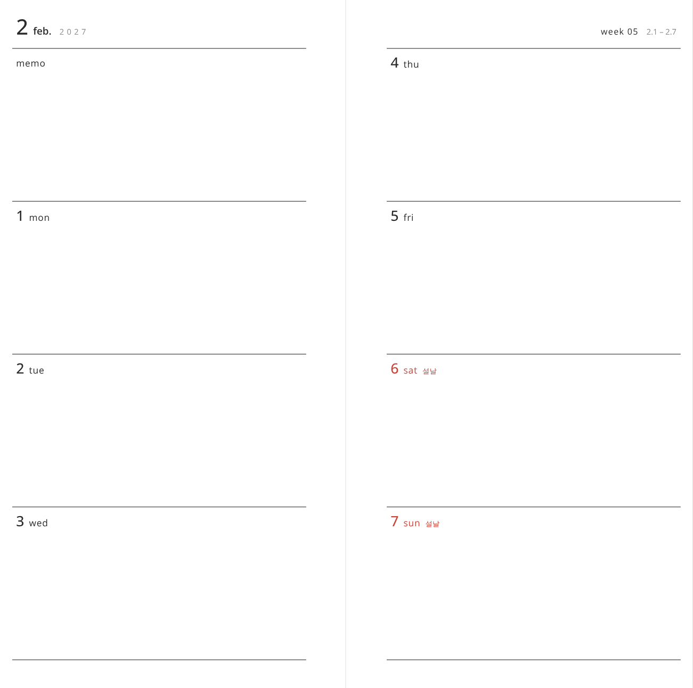

# Diary Weekly Generator

**한국어** | [English](README.en.md)

시스템 다이어리용 위클리 속지를 만들어 PDF로 저장하는 편집 도구예요. 설치 없이 브라우저에서 바로 써요.

**바로 쓰기:** https://mov-ie.github.io/diary-weekly-generator/

## 어떤 속지인가요

펼침면 두 쪽이 한 주예요. 한 쪽에 칸이 4개씩, 모두 8칸이 같은 크기로 나뉘어요.

- **왼쪽 쪽:** 맨 위 메모 칸 + 첫 3일 (월요일 시작이면 월·화·수)
- **오른쪽 쪽:** 나머지 4일 (목·금·토·일)
- **머리줄:** 왼쪽 쪽 위에 월·연도, 오른쪽 쪽 위에 주차(week 05)와 기간(2.1 – 2.7)

기본 크기는 86×171mm이고, 원하는 크기로도 만들 수 있어요.

## 할 수 있는 것

- **기간:** 시작 날짜와 끝 날짜를 고르면 그 날짜가 든 주부터 끝 날짜가 든 주까지 만들어요(한 번에 110주까지).
- **주 시작:** 월요일(기본) 또는 일요일.
- **메모 칸 이름:** 기본은 memo이고, to do, note처럼 원하는 이름으로 바꿀 수 있어요.
- **만년형:** 날짜 없이 요일만 들어간 속지를 원하는 주 수만큼 만들어요.
- **머리줄:** 달 표시(1 / 01 / jan / 1 jan.), 연도·주차·기간 표시를 각각 켜고 끌 수 있어요. 달이 바뀌는 주는 "3 mar. – 4 apr."처럼 나오고, 칸 안의 1일에는 "1 apr."처럼 달이 붙어요. 주차는 ISO 기준이에요.
- **빨간날:** 일요일과 한국 공휴일(대체공휴일 포함)을 빨간색으로 표시하고 칸에 공휴일 이름도 적어요. 공휴일은 매달 자동으로 갱신돼요(아래 참고). 날짜를 직접 추가할 수도 있고, 날짜 뒤에 이름을 적으면 칸에 같이 나와요.
- **글꼴:** Open Sans(기본), Jost 등에서 고르거나 컴퓨터에 설치된 폰트 이름을 직접 입력해요. 월·날짜·요일 글자 크기, 요일 표기(mon / MON), 기울임.
- **색과 선:** 선 색(기본 #1A1A1A), 선 굵기, 글자 색, 빨간날 색, 연도·기간 색, 토요일 색. 색은 고르개로 고르거나 헥사 코드(#1A1A1A)로 직접 입력할 수 있어요.
- **크기와 여백:** 속지 폭·높이, 위·아래 여백, 링 쪽 여백(기본 10mm), 바깥 여백, 머리줄 높이.
- **링 위치 표시:** 미리보기에 링 자리(연한 띠, 점선, 구멍 테두리, 6공 바이블 규격)를 보여 줘요. 화면에서만 보이고 인쇄되지 않아요.
- **출력 배치:** 속지 크기 그대로 저장하거나, A4·A5 한 장에 여러 쪽을 재단선과 함께 배치해요. 단면과 양면을 고를 수 있어요.

## 사용법

1. 페이지를 열어요.
2. 왼쪽 패널에서 **시작 날짜**와 **끝 날짜**, **주 시작** 요일을 골라요.
3. 메모 칸 이름, 글꼴, 색, 여백을 원하는 대로 바꾸세요. 오른쪽 미리보기가 바로 바뀌어요.
4. **출력 용지**를 고르세요.
   - **속지 크기:** 실제 크기로 한 쪽씩 저장해요.
   - **A4 / A5:** 한 장에 여러 쪽을 배치해요. 86×171mm는 A4 가로에 3쪽, A5에 1쪽이 들어가요.
5. 맨 아래 **PDF로 저장 / 인쇄**를 누르고, 인쇄 창에서 **PDF로 저장**을 고르세요.

설정은 브라우저에 저장돼서 다음에 열어도 그대로예요. 처음 상태로 돌리려면 **처음 설정으로 되돌리기**를 누르세요.

## 공휴일 자동 업데이트

공휴일은 `holidays.json` 파일에 들어 있고, 페이지가 열릴 때 이 파일을 읽어요.

- **GitHub Actions**가 매달 1일에 공공데이터포털의 *한국천문연구원 특일 정보* API에서 공휴일을 받아 `holidays.json`을 갱신해요. 대체공휴일과 임시공휴일도 발표되면 반영돼요.
- 빨간날 자료는 이렇게 나뉘어요.
  - **발표된 해:** API로 받은 공식 공휴일이에요.
  - **2029~2030년:** 미리 계산해 둔 추정 공휴일이에요(설날·추석·부처님오신날·대체공휴일 포함, 선거일이나 임시공휴일은 빠져 있어요). API에 공식 자료가 나오면 자동으로 바뀌어요.
  - **그 뒤의 해:** 발표되기 전까지는 일요일만 빨간색이에요.
- 매달 작년부터 5년 뒤까지 확인해서, 새로 발표된 해는 다음 실행 때 자동으로 채워져요.
- 공개 저장소에서는 GitHub Actions가 무료예요.
- 저장소에 활동이 60일 넘게 없어도 예약 실행이 멈추지 않도록, 실행할 때마다 스스로 다시 켜 둬요.

### 처음 한 번만 설정하기

1. [공공데이터포털](https://www.data.go.kr)에서 **한국천문연구원_특일 정보**를 검색해 활용 신청을 해요. 승인되면 마이페이지에서 인증키를 볼 수 있어요(인코딩·디코딩 키 아무거나 괜찮아요).
2. 이 저장소의 **Settings → Secrets and variables → Actions → New repository secret**에서 이름은 `HOLIDAY_API_KEY`, 값은 인증키로 저장해요.
3. **Actions** 탭 → **Update holidays** → **Run workflow**를 눌러 한 번 바로 실행해 보세요. 성공하면 `holidays.json`이 갱신된 커밋이 생겨요.

키가 없으면 업데이트만 건너뛰고, 페이지는 들어 있는 자료로 그대로 동작해요. 페이지 파일을 내려받아 PC에서 바로 열 때도 내장된 자료를 써요.

## 프린트 팁

**인쇄 창 설정**
- 배율은 **100% (실제 크기)**로 두세요. "용지에 맞추기"가 켜져 있으면 속지가 줄어들어요.
- 여백은 **없음**으로 하세요.
- **머리글과 바닥글**을 끄세요.
- 용지 크기가 자동으로 잡히지 않으면 **Chrome**으로 열어 보세요.

**양면 인쇄**
- 양면 배치에서는 낱장 앞면에 지난주 오른쪽 쪽, 뒷면에 이번 주 왼쪽 쪽이 들어가요. 순서대로 끼우면 한 주가 마주 보여요. 첫 낱장 앞면은 비어 있어요.
- 세로 배치는 **긴 쪽 넘기기**, 가로 배치는 **짧은 쪽 넘기기**로 출력하세요. 패널에도 안내가 나와요.
- 앞뒷면이 조금 어긋나면 **뒷면 가로/세로 보정 (mm)** 에 값을 넣으세요. A4·A5 양면에서 뒷면만 그만큼 옮겨 출력해요. 가로는 + 가 오른쪽, 세로는 + 가 아래쪽이에요(뒷면을 바라본 방향). 한 장을 시험 인쇄해 빛에 비춰 재단선이 어긋난 만큼 반대로 넣으면 돼요.

**재단과 용지**
- 한 장만 먼저 뽑아서 자로 크기를 재 보세요.
- 재단선을 켜면 각 쪽 경계에서 용지 끝까지 자를 위치가 그려져요.
- 프린터는 보통 가장자리 3~5mm를 못 찍어요. **프린터 안전 여백**에 그 값을 넣어 두면 잘리지 않게 배치해요.

## 같이 쓰면 좋은 도구

- [Monthly Generator](https://mov-ie.github.io/monthly-generator/): 같은 스타일의 먼슬리 속지와 A4 큰 달력.
- [Habit Tracker Generator](https://mov-ie.github.io/habit-tracker-generator/): 같은 스타일의 해빗트래커 속지.
- [Diary Note Generator](https://mov-ie.github.io/diary-note-generator/): 같은 스타일의 노트 속지(줄, 스퀘어, 도트).
- [Sudoku Generator](https://mov-ie.github.io/diary-sudoku-generator/): 같은 스타일의 스도쿠 속지.

## 라이선스

페이지에 들어 있는 Open Sans, Jost 폰트는 SIL Open Font License 1.1을 따라요([OFL.txt](OFL.txt)).
